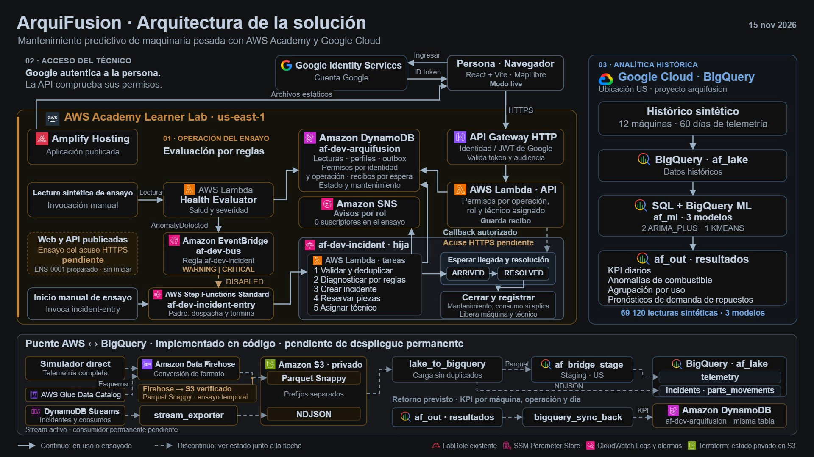

# ArquiFusion Fleet Intelligence

ArquiFusion ayuda a un equipo de mantenimiento a decidir cuándo intervenir una máquina, qué repuesto reservar y a quién asignar la reparación. AWS Academy coordina la atención del incidente. Google Cloud analiza el histórico de la flota para detectar consumos anómalos y anticipar la demanda de piezas.

[](docs/architecture.png)

[PNG para Canvas](docs/architecture.png) · [JPG original](docs/architecture.jpg) · [Arquitectura y evidencias](docs/arquitectura.md) · [Web de la demo](https://demo.d2ygcm34t8aku9.amplifyapp.com)

## Dos nubes

| Nube | Qué hace | Servicios |
|---|---|---|
| **AWS Academy Learner Lab** (`us-east-1`) | Evalúa salud y coordina incidentes, técnicos y stock. La web identifica a la persona con Google y la API comprueba su operación, rol y asignación. | Lambda, Step Functions Standard, DynamoDB, EventBridge, SQS, SNS, API Gateway HTTP con autorizador JWT, Amplify Hosting, SSM y CloudWatch |
| **Google Cloud** (proyecto `arquifusion`, ubicación `US`) | Analiza 69 120 lecturas sintéticas de 12 máquinas durante 60 días. Dos modelos ARIMA_PLUS y un KMEANS producen resultados sobre combustible, uso de la flota y demanda de piezas. | BigQuery y BigQuery ML |
| **Puente operativo** (AWS Academy y proyecto `airi-erp`) | Lleva la telemetría de la operación inscrita a BigQuery y devuelve el KPI diario a DynamoDB. | Firehose, Glue, S3, SQS, API Gateway REST, Cloud Run Jobs, Cloud Scheduler y BigQuery |

**Qué se probó.** En Academy, el ensayo manual `INC-a8c8` terminó con dos acuses, un mantenimiento y una pieza consumida. El técnico confirmó acceso a la web de `ENSAYO-0001`. Al corte de la lámina, sigue pendiente grabar la llegada y la resolución de `ENS-0001` por HTTPS. En Google Cloud, el equipo ejecutó los modelos sobre el histórico sintético. [Evidencia de AWS](docs/evidencias/2026-11-15-academy.json) · [Ensayo web](https://github.com/alxgr-08/arquifusion/issues/23) · [Resultados de BigQuery](analytics/README.md)

**Puente entre nubes.** Dos lecturas de `BRG-8115` llegaron a BigQuery desde dos archivos Parquet de Academy. El trabajo de Cloud Run devolvió a DynamoDB un KPI de 38 toneladas y 17 litros. El 15 de noviembre a las 21:52 de Lima, Cloud Scheduler volvió a procesar la notificación del primer archivo. Se conservaron las dos lecturas y un único KPI. El horario procesa archivos recibidos en S3 con la PC del operador apagada. [Evidencia del puente permanente](docs/evidencias/2026-11-15-puente-permanente.json) · [Operación y alcance](infra/bridge_airi/README.md)

En el Learner Lab, alcanzar diez ejecuciones Lambda simultáneas pone en riesgo la cuenta compartida. La TA indicó ejecutar la ingesta con Python/Boto3 desde una máquina. La demo utiliza un evento manual de incidente, la regla EventBridge deshabilitada y los datos históricos ya cargados en BigQuery. [Estado, restricciones y recorrido del ensayo](docs/arquitectura.md)

## Cómo responde a la rúbrica

| Criterio | Dónde está |
|---|---|
| Persistencia y alta disponibilidad | DynamoDB regional bajo demanda con PITR, Streams, TTL y protección contra borrado. La aplicación conserva alertas pendientes y recibos de acuse por espera. [Configuración de la tabla](infra/aws/dynamodb.tf) |
| Step Functions | Flujo de incidente: correlación, reserva de pieza, diagnóstico, asignación, avisos y dos esperas con callback (llegada y resolución) ([`statemachines/`](statemachines/)) |
| Dos nubes | AWS para la operación, GCP BigQuery/BigQuery ML para la analítica |
| Serverless | La aplicación y el flujo de incidentes utilizan servicios administrados. El equipo opera la demo sin aprovisionar servidores. |
| IA | BigQuery ML detecta anomalías de combustible, pronostica demanda de repuestos y agrupa máquinas por uso. En Academy, el diagnóstico del incidente se ejecuta por reglas. [Consultas de demostración](analytics/demo_queries.sql) |
| Seguridad de variables globales | SSM Parameter Store para la configuración de las Lambdas; sin secretos en código, Terraform ni Vite. Acceso con Google Sign-In, autorizador JWT y permisos por operación y rol en DynamoDB |

## Equipo

| Rol | Integrante | Responsable de |
|---|---|---|
| Rol 1 · Arquitectura cloud e infraestructura | Leonardo (`leonardopanduro-rgb`) | `infra/`, seguridad, CI/CD, lago de datos, diagrama |
| Rol 2 · Backend y orquestación | Sebastián (`sebastianperez72`) | simulador, inyector de fallas, `statemachines/`, incidentes, técnicos, avisos, API |
| Rol 3 · Datos, IA y producto | Alexis (`alxgr-08`) | evaluador de salud, diagnóstico, `analytics/`, retorno de KPIs, `frontend/`, pitch |

## Estructura

| Ruta | Contenido |
|---|---|
| `contracts/` | JSON Schemas, ejemplos y contrato HTTP |
| `services/` | Una carpeta por Lambda |
| `statemachines/` | ASL de Step Functions |
| `shared/` | Modelos Pydantic y utilidades comunes |
| `analytics/` | SQL de BigQuery y BigQuery ML, histórico sintético y consultas de la demo |
| `frontend/` | React + Vite + TypeScript |
| `infra/aws`, `infra/gcp`, `infra/hosting` | Terraform y scripts de despliegue |
| `docs/` | Arquitectura, decisiones y guion de la demo |

## Ejecutar en local

```bash
python -m venv .venv
# Windows: .venv\Scripts\activate   |   Linux/Mac: source .venv/bin/activate
pip install -r requirements-dev.txt
python scripts/validate_contracts.py
python scripts/run_tests.py

cd frontend && npm ci && npm run dev   # modo mock por defecto
```

## Flujo de trabajo

`main` está protegida: cambios por PR con CI verde (`python`, `frontend`), Conventional Commits en inglés y squash merge. Más detalle en [`docs/ONBOARDING.md`](docs/ONBOARDING.md).
