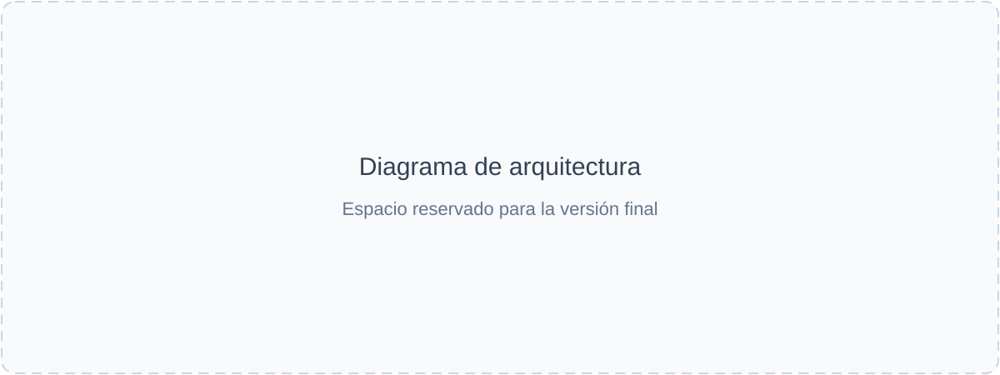

# ArquiFusion Fleet Intelligence

[](https://github.com/alxgr-08/arquifusion/actions/workflows/ci.yml)
[](https://github.com/alxgr-08/arquifusion/actions/workflows/terraform.yml)
[](https://github.com/alxgr-08/arquifusion/actions/workflows/security.yml)

ArquiFusion ayuda a un equipo de mantenimiento a decidir cuándo intervenir una máquina, qué repuesto reservar y a quién asignar la reparación. AWS coordina la operación y los incidentes. Google Cloud analiza el histórico para detectar consumos anómalos y anticipar la demanda de piezas.

[Abrir la demo](https://demo.d2ygcm34t8aku9.amplifyapp.com) · [Arquitectura y evidencias](docs/arquitectura.md) · [Preparar el entorno](docs/ONBOARDING.md)

## Arquitectura

<!-- DIAGRAMA: reemplazar esta imagen por docs/architecture.png al incorporar la versión final. -->

<!-- FIN DIAGRAMA -->

La descripción de los componentes y sus evidencias está en [docs/arquitectura.md](docs/arquitectura.md). Los diagramas anteriores se conservan allí como referencia histórica.

## Qué hace cada nube

| Entorno | Responsabilidad | Componentes principales |
|---|---|---|
| AWS Academy · `us-east-1` | Evaluar salud, coordinar incidentes, reservar stock y asignar técnicos; servir la API autenticada y la web. | Lambda, Step Functions, DynamoDB, EventBridge, SQS, SNS, API Gateway, Amplify, SSM y CloudWatch. |
| Google Cloud · proyecto `arquifusion` | Analizar el histórico sintético: 12 máquinas, 60 días y 69 120 lecturas; pronosticar repuestos y detectar anomalías. | BigQuery y BigQuery ML: dos modelos ARIMA_PLUS y un KMEANS. |
| Puente · AWS Academy y proyecto `airi-erp` | Transferir los archivos recibidos y devolver KPIs a DynamoDB cada hora. | Firehose, Glue, S3 privado, SQS, API Gateway REST, Cloud Run Jobs, Cloud Scheduler y BigQuery. |

## Automatización y alcance

| Proceso | Comportamiento |
|---|---|
| Revisión de cada PR y de `main` | Lint, contratos, pruebas Python y frontend, enlaces internos, archivos JSON y control de archivos sensibles. Terraform valida y ensaya planes con proveedores simulados cuando cambian sus entradas. |
| Seguridad | Escaneo del historial Git y del checkout con valores ocultos; auditoría de dependencias Python, paquetes Lambda y frontend. Se repite semanalmente. Dependabot propone actualizaciones semanales. |
| Paquete web | La CI genera un ZIP de la vista previa en modo `mock`, con sus reglas SPA, disponible como artefacto durante siete días. |
| Puente en servicio | Cloud Scheduler ejecuta Cloud Run cada hora, al minuto 52, hora de Lima. Procesa hasta diez notificaciones recibidas en S3, deduplica las lecturas y confirma el KPI antes de retirar cada mensaje. Funciona con la PC del operador apagada. |
| Ingesta y flujo de incidentes | El productor Python/Boto3 envía las lecturas. En Academy, la regla de incidentes permanece deshabilitada por el límite compartido de diez ejecuciones Lambda concurrentes. Los acuses de llegada y resolución corresponden al técnico. |
| Publicación e infraestructura | Terraform y los scripts preparan los cambios. La publicación live, los cambios cloud y el pipeline histórico de BigQuery ML conservan su ejecución controlada; la CI usa pruebas sin credenciales cloud. |

El puente horario ya tiene [evidencia de dos lecturas, retorno y reentrega sin duplicados](docs/evidencias/2026-11-15-puente-permanente.json). El ensayo previo de incidentes cerró con dos acuses, un mantenimiento y una pieza consumida. La grabación del recorrido HTTPS de `ENS-0001` sigue registrada como pendiente en el [estado de arquitectura](docs/arquitectura.md). La generación de telemetría y el entrenamiento histórico tienen ciclos independientes del programador del puente.

## Seguridad

Las identidades de ejecución acceden a AWS y Google Cloud mediante roles o cuentas de servicio. La web utiliza Google Sign-In, JWT y permisos por operación y rol en DynamoDB. Los parámetros de las Lambdas se obtienen de SSM.

Los archivos `.env`, claves privadas, credenciales Google, estados y planes Terraform quedan fuera de Git y la CI rechaza su incorporación. Todo valor `VITE_*` se distribuye al navegador: solo admite configuración pública. El OAuth client ID, los nombres de proyecto y las URLs públicas identifican recursos; las claves y los tokens de sesión deben permanecer fuera del repositorio. [Política de seguridad](SECURITY.md)

## Ejecutar en local

Requisitos: Python 3.12 y Node.js 22 con npm.

```sh
python -m venv .venv
# Windows: .venv\Scripts\activate | Linux/macOS: source .venv/bin/activate
python -m pip install -r requirements-dev.txt
python scripts/check_repository.py
python scripts/validate_contracts.py
python scripts/run_tests.py
python -m ruff check .
npm --prefix frontend ci
npm --prefix frontend test
npm --prefix frontend run build
npm --prefix frontend run dev
```

El entorno de desarrollo inicia en modo `mock`. Las pruebas offline no necesitan una sesión AWS o Google; los comandos completos y los controles automáticos se describen en [ONBOARDING](docs/ONBOARDING.md).

## Estructura

| Ruta | Contenido |
|---|---|
| `contracts/` | JSON Schemas, ejemplos y contrato HTTP. |
| `services/`, `shared/`, `statemachines/` | Funciones, modelos compartidos y flujos de Step Functions. |
| `analytics/` | Generador sintético, SQL y modelos BigQuery ML del histórico. |
| `frontend/` | React, Vite y TypeScript. |
| `infra/aws/`, `infra/gcp/`, `infra/bridge_airi/`, `infra/hosting/` | Terraform, puente horario y herramientas de publicación. |
| `.github/`, `scripts/` | CI, controles de seguridad y utilidades locales. |
| `docs/` | Arquitectura, decisiones, evidencias y guion de la demo. |

## Equipo y contribuciones

| Rol | Integrante | Responsabilidad |
|---|---|---|
| 1 | Leonardo · `leonardopanduro-rgb` | Infraestructura, seguridad, CI/CD, lago y arquitectura. |
| 2 | Sebastián · `sebastianperez72` | Backend, simulación, incidentes, técnicos, notificaciones y API. |
| 3 | Alexis · `alxgr-08` | Salud, datos, IA, frontend y pitch. |

Los cambios se integran por PR con los controles automáticos en verde, Conventional Commits en inglés y squash merge. [CODEOWNERS](.github/CODEOWNERS) identifica a los responsables. La entrega incluye video de hasta cinco minutos, repositorio y diagrama final.
