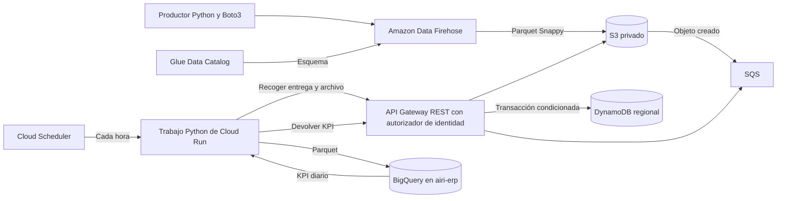

# Arquitectura y estado de ArquiFusion

ArquiFusion ayuda a decidir cuándo detener una máquina, qué pieza reservar y a quién asignar la reparación. AWS Academy Learner Lab opera incidentes en `us-east-1`. Google Cloud analiza un histórico sintético de la flota en BigQuery. La lámina del 15 de noviembre de 2026 muestra el estado previo al ensayo web conjunto. [PNG para Canvas](architecture.png) · [JPG original](architecture.jpg)

El diagrama técnico complementario organiza los mismos recorridos por componente y conserva su fuente editable. [Draw.io](architecture.drawio) · [SVG](architecture.svg)

## Qué se puede demostrar

| Problema | Recorrido | Evidencia disponible |
|---|---|---|
| Una avería se detecta tarde | Health Evaluator evalúa la salud por reglas, conserva lectura y perfil en DynamoDB y publica anomalías en EventBridge | Dos lecturas sintéticas de un ensayo anterior produjeron salud 100 y 0. El bus aceptó la anomalía. La regla `af-dev-incident` está `DISABLED`. La evidencia se puede mostrar sin enviar telemetría nueva. |
| Taller, almacén y técnico pierden el hilo de la atención | Una ejecución manual de `af-dev-incident-entry` despacha la hija `af-dev-incident`. La hija reserva, asigna, espera llegada y resolución y registra mantenimiento y consumo | El ensayo anterior `INC-a8c8` cerró con dos recibos, un mantenimiento y una pieza consumida. El reenvío se deduplicó. El tema SNS tiene cero suscriptores. [Evidencia del ensayo anterior](evidencias/2026-11-15-academy.json) |
| Una persona podría confirmar un incidente ajeno o repetir un acuse | Amplify sirve React por HTTPS. Google identifica a la persona. API Gateway valida el JWT en doce rutas. La API consulta operación, rol y técnico asignado en DynamoDB y vincula cada acuse a la espera revisada con ETag | Amplify `demo`, publicación 2 exitosa. Sebastián confirmó el login, la operación y la vista de `T-E0001`. En el corte quedan pendientes los dos acuses por HTTPS para `ENS-0001`. [Publicación](https://github.com/alxgr-08/arquifusion/pull/55#issuecomment-6901640824) · [Confirmación del técnico](https://github.com/alxgr-08/arquifusion/issues/23#issuecomment-6902549983) |
| Se planifican combustible y repuestos sin histórico | BigQuery `af_lake` alimenta SQL y BigQuery ML en `af_ml`. Los resultados de consumo, segmentos y demanda de piezas llegan a `af_out` | En el proyecto `arquifusion`, ubicación US, el equipo documentó 12 máquinas, 60 días, 69 120 lecturas sintéticas, 25 incidentes y 108 movimientos. Hay dos modelos ARIMA_PLUS, un KMEANS y nueve tablas de resultados. [Analítica](../analytics/README.md) · [Consultas de demostración](../analytics/demo_queries.sql) |

## Puente de telemetría en servicio

Después de generar la lámina para Canvas, Leonardo desplegó el puente en AWS Academy y en su proyecto Google `airi-erp`. Cloud Run usa la identidad de servicio del trabajo. El autorizador de la API de máquina a máquina comprueba esa identidad y las integraciones nativas acceden a la cola, el archivo y el KPI. El programador solo procesa datos que ya se recibieron. [Recorrido verificado con dos lecturas](evidencias/2026-11-15-puente-permanente.json) · [Configuración y operación](../infra/bridge_airi/README.md)

## Componentes con alcance separado

| Componente en el repositorio | Alcance comprobado |
|---|---|
| DynamoDB Streams → `stream_exporter` → S3 | El stream de la tabla está activo. La proyección de incidentes y consumos a NDJSON se probó localmente. Al corte había cero mapeos a Lambdas del proyecto. |
| `lake_to_bigquery` y `bigquery_sync_back` para los datasets históricos | El repositorio conserva esos adaptadores y sus pruebas locales. El puente horario de telemetría usa el trabajo Python de Cloud Run, el dataset `airi-erp.af_bridge` y la fórmula de KPI del equipo. El entrenamiento y las predicciones históricas pertenecen al proyecto `arquifusion`. [Alcance del histórico](https://github.com/alxgr-08/arquifusion/issues/14#issuecomment-6901536999) · [Prueba local de los adaptadores](../services/api/tests/test_multicloud_rehearsal.py) |
| Simulador periódico, mantenimiento preventivo y detector offline | Son capacidades de código. La sesión de demostración usa un evento manual de incidente. El diagnóstico que aparece en AWS utiliza reglas. |

## Límite del Learner Lab y operación del ensayo

La TA indicó que **alcanzar diez ejecuciones Lambda simultáneas puede desactivar la cuenta** y que la ingesta debe ejecutarse con Python/Boto3 desde una máquina. El productor envía los registros a Firehose. La Lambda del puente recibe únicamente el token de identidad para autorizar solicitudes. Cloud Run procesa la telemetría con una tarea por ejecución. La concurrencia regional de Lambda se comparte con los demás proyectos.

El ensayo manual previo también completó el recorrido con una lectura y dos sesiones de operador. El archivo de evidencia permite contrastar ese ensayo con la ejecución posterior del trabajo programado. [Ensayo manual](evidencias/2026-11-15-puente-airi.json)

El ensayo del incidente utiliza pasos distintos de la ingesta. Leonardo graba Step Functions. Sebastián abre una sola pestaña de la vista del técnico y hace los dos acuses humanos. El ASL contiene un bloque de tres ramas y un mapa de notificaciones con hasta cinco iteraciones concurrentes. La espera del callback reside en Step Functions. El límite del stage, una solicitud por segundo y ráfaga de cuatro, controla solicitudes HTTP. La métrica regional `AWS/Lambda · ConcurrentExecutions · Maximum` incluye la carga de los demás proyectos y llega con retraso. Si la actividad compartida impide mantener margen, el equipo presenta la evidencia anterior o reprograma la prueba. [Definición del flujo](../statemachines/incident.asl.json) · [Métrica de concurrencia](https://docs.aws.amazon.com/lambda/latest/dg/monitoring-concurrency.html)

## Inventario de la operación

El estado remoto de la aplicación contiene **60 recursos administrados** y una consulta del LabRole existente. La tabla `af-dev-arquifusion` está activa, con dos índices, Streams, TTL, PITR y protección contra borrado. El bucket privado de estado tiene versionado, cifrado y bloqueo público. El bootstrap conserva su estado separado. En AWS también están los dos flujos Standard, seis Lambdas, el bus, la regla deshabilitada y su cola de fallos, el tema SNS, los parámetros SSM, logs y alarmas, API Gateway y Amplify.

## Cierre para Canvas

1. **Leonardo** conserva el único evento preparado de `ENS-0001`, comprueba disponibilidad de la cuenta y graba la ejecución hija cuando ambos operadores estén listos y el ensayo esté autorizado. Conserva el ID del incidente y la evidencia final.
2. **Sebastián** confirma llegada y resolución como `T-E0001`, revisa el ETag de cada espera y graba la web. El cierre se acredita con dos recibos certificados, un mantenimiento, una unidad de `BRG-SPH-22` consumida en `WH-E0001` y la liberación del técnico y de la máquina. El éxito del flujo padre solo acredita el despacho.
3. **Alexis y el equipo** completan el clip real de BigQuery ML y ensamblan el video de hasta cinco minutos. Tras revisar las evidencias, actualizan el estado del ensayo en el diagrama y entregan video, enlace al repositorio accesible al jurado y PNG. [Coordinación del ensayo](https://github.com/alxgr-08/arquifusion/issues/23) · [Video](https://github.com/alxgr-08/arquifusion/issues/7) · [Diagrama](https://github.com/alxgr-08/arquifusion/issues/19)
