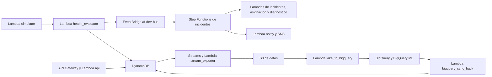

# Auditoría inicial de arquitectura e infraestructura

Corte histórico. Para el estado vigente consultar la arquitectura: [ArquiFusion](arquitectura.md).

Documento histórico del bootstrap. El inventario actual, los planes de revisión y los pendientes del equipo están en la [entrega de Rol 1](entrega-rol1.md).

## Reconciliación del bootstrap el 14 de noviembre de 2026

El bucket `af-dev-tfstate-<ACCOUNT_ID>` existe en `us-east-1`. Se verificaron el perfil
`default`, la cuenta propietaria con `HeadBucket --expected-bucket-owner` y las etiquetas
`project=arquifusion`, `env=dev` y `owner=rol1`. El despliegue inicial creó el bucket.
La política de control del laboratorio denegó `s3:GetBucketObjectLockConfiguration`
durante la lectura posterior y Terraform dejó la referencia del bucket marcada `tainted`.

Se respaldó el estado local de serie 2, se importaron por nombre las configuraciones
de versionado, cifrado y acceso público, y `terraform state rm aws_s3_bucket.tfstate`
retiró la referencia anterior del estado local. La serie 6 conserva el mismo linaje.
Terraform consulta el bucket como dato y gestiona sus tres controles. El respaldo
previo está en `build/terraform-review/bootstrap-reconciliation-20261115T004430660799Z/terraform.tfstate.before`.

El plan completo con refresco `build/terraform-review/bootstrap-versioning.tfplan`
propone un único cambio en sitio de `Disabled` a `Enabled`, con cero altas, bajas o
reemplazos. Su SHA-256 es `E268F5DE6AA222ADD6E0532827E35E4BCB3A36FF8CFF43CBA01D96866B70957F`.
S3 confirmó después del plan que el versionado seguía sin habilitar. El cifrado AES256
y los cuatro bloqueos públicos están activos. El permiso `s3:PutBucketVersioning` sigue
`NO_PROBADO`. El backend de la aplicación y DynamoDB quedaron fuera de esta operación.

## Preparación de Prompt 1 antes de crear el bucket

Revisión renovada del 14 de noviembre de 2026, después de recibir el paquete de
contexto de Leonardo. Se leyeron `AGENTS (1).md`, `LEEME_PRIMERO.md` y los siete
Markdown numerados 01 a 07 desde `C:\Users\Cuycito\Proyectos`. Esos originales
están sueltos en la carpeta padre y todavía no ocupan las rutas `AGENTS.md` y
`docs/codex/` descritas por el paquete. Las copias duplicadas de 01 y 02 tienen el
mismo SHA-256. La lectura se completó desde los originales encontrados.

### Repositorio realmente examinado

| Elemento | Resultado actual |
|---|---|
| Directorio | `C:\Users\Cuycito\Proyectos\arquifusion` |
| Rama de trabajo | `infra/rol1-aws-bootstrap` |
| HEAD y main local | `5401e3c790161981d7ab31383b3f1a16210818fe` |
| origin/main y main remoto | `be19d3e6ae2316b8254f2fd7f3458f15ca2f0328` |
| Cambio remoto | `R2 pr combination fixes (#40)`, 14 de noviembre, 19:04:33 de Lima |
| Diferencia | 0 commits locales por delante y 1 remoto por integrar |
| Acceso Git y API GitHub con autenticación local | Confirmado, fetch y consulta de PR completados |
| Conector GitHub | 404 al leer el repositorio privado |
| PR #40 | Integrada por Sebastián |
| PR #31 a #37 | Cerradas individualmente sin merge directo de esas PR |

El código de evaluador, diagnóstico, BigQuery ML, sync-back y frontend está presente
en `origin/main` por #40. El checkout local continúa en el commit anterior con sus
modificaciones de infraestructura preservadas. Se leyó el contenido remoto mediante
`git show` y una copia de contratos en `build/`. Las conclusiones del registro histórico
posterior sobre PR abiertas y esqueletos corresponden exclusivamente al corte anterior.

### Contraste con el paquete Academy y el código

| Tema | Resultado de la revisión actual |
|---|---|
| Claves de tabla | PK/SK, GSI1 y GSI2 son iguales entre HEAD y origin/main. Se conserva proyección `ALL`. |
| Ingreso API Gateway | Propuesto por Academy. El simulador remoto mantiene `iot`/`direct`, y el evaluador recibe telemetría plana. El adaptador HTTP requiere coordinación. |
| IA | Los SQL/modelos de BigQuery ML están en origin/main. La ejecución real GCP sigue sin evidencia en esta tarea. |
| Diagnóstico | Los contratos actuales usan `ai-diagnosis-request` y `ai-diagnosis-response`. El backend de #40 ya los adoptó. |
| Forecast | El preventivo remoto consume `forecastQty` y conserva compatibilidad con `demand`. La incompatibilidad histórica está resuelta. |
| KPI | `watchHours` y `loadRatio` son opcionales en el preventivo remoto. |
| Raw y archivo | El evaluador sigue guardando una lectura reducida sin `context` ni toda la estructura requerida por el DDL de telemetría. Coordinar conservación de raw antes de la ruta alternativa sin Firehose. |
| Publicación | Sigue ocurriendo después de persistir. Outbox y recuperación son propuestas pendientes para la etapa de Lambda/incidentes. |
| TTL | `expiresAt` sigue siendo fijado por el escritor a 48 h. La política de pendientes de archivo necesita acuerdo antes de probar histórico completo. |
| Regiones y cifrado | Primera preparación regional y cifrado administrado según el paquete. `CLAUDE.md` mantiene el diseño original de réplica y KMS propia. La decisión cloud se revisa por etapa. |
| IAM | Bucket y tabla se preparan sin rol de ejecución. `lab_role_arn` queda disponible para etapas posteriores y requiere un ARN real verificado entonces. |
| Infra GCP y exportadores | Terraform GCP sigue como esqueleto. `lake_to_bigquery` y `stream_exporter` continúan pendientes. |

### Consultas AWS efectivas de esta etapa

Todas mediante AWS CLI, perfil `default`, región `us-east-1`, sin consultar valores
de secretos ni archivos de autenticación.

| Operación | Evidencia actual | Clasificación |
|---|---|---|
| STS GetCallerIdentity | Sesión válida y cuenta utilizada para limitar los planes locales | `LECTURA_CONFIRMADA` |
| S3 ListBuckets | Ningún bucket con prefijo `af-` | `LECTURA_CONFIRMADA` |
| S3 HeadBucket del nombre exclusivo previsto | 404 | Bucket no encontrado en esta consulta |
| DynamoDB DescribeTable de `af-dev-arquifusion` | `ResourceNotFoundException` | Tabla ausente, servicio alcanzado |
| Creación, TTL, PITR, Streams y uso del backend | Sin escrituras de prueba | `NO_PROBADO` |
| IoT, Bedrock, Location, Global Tables y KMS propia | Fuera de las dependencias iniciales del Prompt 1 | `EXCLUIDO_DEL_MVP` inicial |

Las comprobaciones de permisos de la auditoría anterior quedan como antecedentes.
Este turno no renovó el inventario de todos los servicios. El rol de ejecución y
`iam:PassRole` se revisarán al preparar las funciones.

### Planes concretos de revisión

Los archivos están en `build/terraform-review/`, excluidos de Git. Los textos
reemplazan el ID de cuenta por `<ACCOUNT_ID>` y los planes binarios conservan la
cuenta verificada localmente.

| Plan | Resultado | Alcance y SHA-256 |
|---|---|---|
| `bootstrap.tfplan` y `bootstrap.txt` | 4 altas, 0 cambios, 0 eliminaciones | Bucket, versionado, SSE-S3 y bloqueo público. SHA `1CEB401FA633710E71B9CEA9CC597A24A6D7D7B37B933BF989723701EFA72B56` |
| `table-local-rehearsal.tfplan` y `.txt` | 1 alta, 0 cambios, 0 eliminaciones | Ensayo de `aws_dynamodb_table.arquifusion`. SHA `3EDA3DEF75D583BFF330FDCBC8B50986129D1BEA0768D8A132B9CD9307E2BA96` |

El bootstrap utiliza su estado local real. El ensayo de tabla utiliza una copia de
los `.tf` en `table-local/`, con el backend sustituido por `local`, estado vacío y
`-refresh=false`. El código original mantiene el backend S3. El primer intento de
plan de ese ensayo pidió inicializar su backend local, y se completó esa inicialización
local antes de repetirlo. Ambos planes excluyen modificaciones o eliminaciones.

El plan definitivo de la tabla se generará desde `infra/aws/` después de crear el
bucket y autorizar la conexión del backend remoto. Esa conexión puede escribir locks
y estado. El plan de ensayo queda como comprobación del esquema y de las altas previstas.

### Archivos locales nuevos o modificados

El diff acumulado contiene quince archivos. Se conservaron y ajustaron los trabajos
locales de infraestructura que ya existían al iniciar este Prompt 1.

| Archivos | Preparación |
|---|---|
| `.gitignore` | Excluir planes y conservar lockfiles de proveedores |
| `infra/aws/bootstrap/main.tf` | Bucket exclusivo, versionado, SSE-S3 y bloqueo público |
| `infra/aws/bootstrap/terraform.tfvars.example` | Plantilla sin identificadores privados |
| `infra/aws/bootstrap/.terraform.lock.hcl` | AWS 6.73.0 reproducible |
| `infra/aws/dynamodb.tf` | Tabla e índices actuales, TTL, PITR y Streams |
| `infra/aws/outputs.tf` | Nombre, ARN y stream ARN de la tabla |
| `infra/aws/providers.tf` | Perfil y cuenta esperada |
| `infra/aws/variables.tf` | Cuenta esperada y rol opcional para fases posteriores |
| `infra/aws/versions.tf` | Restricciones de proveedores compatibles con el esquema |
| `infra/aws/.terraform.lock.hcl` | AWS 6.73.0 y archive 2.8.1 |
| `infra/aws/backend.hcl.example` | Backend exclusivo S3 con bloqueo nativo |
| `infra/aws/terraform.tfvars.example` | Variables públicas de ejemplo |
| `infra/aws/README.md` | Procedimiento reproducible y límites del ensayo local |
| `docs/decisiones.md` | Preparación local Academy, con decisiones cloud pendientes |
| `docs/auditoria-inicial.md` | Contraste vigente y evidencia histórica identificada |

Los planes y las copias de revisión están en `build/terraform-review/` y no forman
parte de esos quince archivos versionables. Se verificó que los archivos versionables
conservan placeholders para el ID privado de cuenta.

### Validaciones y bloqueos

- `terraform fmt -check -recursive infra/aws`, `init -backend=false` y `validate`
  completados para las raíces AWS y bootstrap. El ensayo de tabla también valida.
- Se reutilizaron AWS 6.73.0 y archive 2.8.1 de los lockfiles, con Terraform 1.17.1.
  `.gitignore` ahora conserva los lockfiles de proveedores y excluye los planes.
- Validación de contratos y Ruff del checkout local completados. `pytest -q` produjo
  53 tests correctos en HEAD `5401e3c`.
- Los seis fixtures de contratos de `origin/main` `be19d3e` validaron en una copia
  aislada. La suite completa de ese commit remoto sigue pendiente, con `moto`,
  Powertools y Anthropic ausentes de la venv local.
- El commit remoto está descargado como referencia y pendiente de integración en
  la rama de trabajo. Esto debe resolverse antes de empaquetar o desplegar servicios.
- Los permisos de escritura y el funcionamiento cloud siguen `NO_PROBADO`.
  Los estados de esta entrega son `PREPARADO` y `VALIDADO_LOCAL`.

La primera autorización a revisar corresponde únicamente a los cuatro recursos del
bucket exclusivo `af-dev-tfstate-<ACCOUNT_ID>` en `us-east-1`, con etiquetas
`project=arquifusion`, `env=dev`, `owner=rol1`, `force_destroy=false` y protección
Terraform contra destrucción. El bucket todavía no se creó. Regenerar y revisar
el plan si cambia la configuración o el estado antes de una futura ejecución.

## Registro histórico de la auditoría anterior

El contenido restante conserva la fotografía de `5401e3c` anterior a la PR #40.
Para decisiones actuales prevalece la actualización de Prompt 1 anterior.

Revisión del 14 de noviembre de 2026 para Rol 1. Perfil AWS CLI `default`, región
principal `us-east-1` y rama local `infra/rol1-aws-bootstrap`.

## Acceso al equipo y estado de Git

Se confirmó lectura de la copia local en `C:\Users\Cuycito\Proyectos\arquifusion`,
incluidos `CLAUDE.md`, onboarding, decisiones, contratos, servicios y Terraform.
La rama estaba limpia al comenzar. La auditoría agregó únicamente infraestructura
y documentación local.

El repositorio remoto privado es accesible mediante Git y la API de GitHub con la
autenticación local de Git. `git ls-remote` y `git fetch origin` funcionaron.
El conector de GitHub de Codex devuelve 404 para el repositorio y 422 al consultar PR.
Para usar ese conector hace falta concederle acceso al repositorio privado en GitHub.
La autenticación local permite realizar la revisión solicitada.

`main` local, `origin/main`, `main` remoto y HEAD de la rama de trabajo coinciden en
`5401e3c790161981d7ab31383b3f1a16210818fe`, `R2 1 (#39)`, de Sebastián,
del 14 de noviembre a las 17:08:08 de Lima. La comparación local/remoto devuelve
0 commits por delante y 0 por detrás. No hay commits nuevos de `main` pendientes de
descargar. Las ramas remotas de Alexis son consultables como `origin/...` después
del fetch y su trabajo sigue pendiente de integración.

| PR | Autor | Rama y último commit | Estado |
|---|---|---|---|
| [#39](https://github.com/alxgr-08/arquifusion/pull/39) | Sebastián | `R2_1`, `a844947` | Integrada en `main`, rama remota eliminada |
| [#38](https://github.com/alxgr-08/arquifusion/pull/38) | Sebastián | `R2_1`, `bd77c86` | Cerrada sin integrar |
| [#31](https://github.com/alxgr-08/arquifusion/pull/31) | Alexis | `feat/rol3-health-score`, `d40f91b` | Abierta |
| [#32](https://github.com/alxgr-08/arquifusion/pull/32) | Alexis | `feat/rol3-health-handler`, `25b8cd0` | Abierta, incluye el motor de #31 |
| [#33](https://github.com/alxgr-08/arquifusion/pull/33) | Alexis | `feat/rol3-ai-diagnosis`, `ad3da0f` | Abierta |
| [#34](https://github.com/alxgr-08/arquifusion/pull/34) | Alexis | `feat/rol3-frontend`, `16b65ec` | Abierta |
| [#35](https://github.com/alxgr-08/arquifusion/pull/35) | Alexis | `feat/rol3-analytics`, `41547de` | Abierta |
| [#36](https://github.com/alxgr-08/arquifusion/pull/36) | Alexis | `feat/rol3-bigquery-sync-back`, `aeb6f1d` | Abierta |
| [#37](https://github.com/alxgr-08/arquifusion/pull/37) | Alexis | `docs/rol3-pitch`, `6f28f61` | Abierta |

## Comprobaciones de AWS Academy

AWS MCP conectó mediante su proxy configurado al proporcionar a ese proceso el PATH
que contiene `uvx`. Se verificaron las llamadas efectivas de `aws___run_script` en
`api_calls`. Una primera ejecución fue rechazada por la validación del sandbox al
usar introspección de excepciones, y la consulta corregida completó las operaciones.
AWS CLI confirmó también la sesión mediante `sts:GetCallerIdentity`.

Los conteos corresponden a inventarios, con paginación completada por MCP. En SSM y
Secrets Manager se filtraron los nombres de ArquiFusion. Se consultaron metadatos.

| Servicio | Clasificación de lectura | Evidencia | Escritura |
|---|---|---|---|
| S3 | Acceso de lectura confirmado | `ListBuckets`, 4 buckets, ninguno con prefijo `af-` | Pendiente de comprobar |
| DynamoDB | Acceso de lectura confirmado | `ListTables`, 15 tablas, ninguna con prefijo `af-` | Pendiente de comprobar |
| Lambda | Acceso de lectura confirmado | `ListFunctions`, 101 funciones, ninguna con prefijo `af-` | Pendiente de comprobar |
| EventBridge | Acceso de lectura confirmado | `ListEventBuses`, 1 bus, ninguno con prefijo `af-` | Pendiente de comprobar |
| Step Functions | Acceso de lectura confirmado | `ListStateMachines`, 0 máquinas de estado | Pendiente de comprobar |
| Parameter Store | Acceso de lectura confirmado para metadatos | `DescribeParameters`, 0 nombres bajo `/af/` | Pendiente de comprobar |
| Secrets Manager | Acceso de lectura confirmado para metadatos | `ListSecrets`, 0 nombres con prefijo `af/` | Pendiente de comprobar |
| LabRole | Acceso de lectura confirmado parcialmente | `GetRole`, 7 políticas adjuntas, 0 inline | Uso con servicios e `iam:PassRole` pendientes |
| Políticas VocLabPolicy | Acceso denegado | `iam:GetPolicy` devolvió `AccessDenied` para las tres políticas del laboratorio | Sin comprobar |
| IoT Core, Bedrock, Location, Global Tables y KMS propia | Disponibilidad sin verificar | Fuera de las consultas necesarias para preparar bucket y tabla | Pendiente de comprobar |

La tabla `af-dev-arquifusion` y el bucket previsto de estado no aparecen en el
inventario de esta cuenta. La disponibilidad global del nombre de S3 sigue sin
verificarse. La región `us-west-2` sigue sin comprobarse.

La confianza de `LabRole` permite `sts:AssumeRole` a `lambda.amazonaws.com`,
`states.amazonaws.com`, `events.amazonaws.com`, `scheduler.amazonaws.com`,
`apigateway.amazonaws.com`, `firehose.amazonaws.com` e `iot.amazonaws.com`, entre
otros. Su duración máxima de sesión es de 3600 segundos y no declara permissions
boundary. Esa duración corresponde al rol y no determina el vencimiento de la sesión
Academy actual.

Las políticas administradas por AWS pudieron leerse. Las políticas propias del lab
están protegidas, lo que impide evaluar completamente los permisos efectivos del rol.
La confianza confirma compatibilidad para asumirlo desde esos servicios. Las acciones
sobre DynamoDB, EventBridge, logs y SSM, junto con `iam:PassRole` del desplegador,
deben verificarse durante la siguiente etapa autorizada.

La prohibición de crear roles IAM se conserva como regla del repositorio y del
alcance de esta revisión. No se probó crear un rol para verificar una denegación.
Las restricciones sobre KMS, Bedrock, IoT, Location y Global Tables siguen siendo
hipótesis del onboarding. Tampoco se leyeron valores de parámetros o secretos.

## Arquitectura propuesta por fases

La primera unidad desplegable es el estado de Terraform y la tabla en `us-east-1`.
La siguiente incorpora el evaluador, su bus EventBridge y la configuración SSM.
El simulador de Sebastián ya implementa invocación directa asíncrona de Lambda con
`AF_INGEST_MODE=direct` y `AF_HEALTH_EVALUATOR_FUNCTION`.
Esto permite empezar con telemetría válida sin introducir un nuevo servicio de ingesta.

El flujo propuesto para completar el sistema utiliza las funciones existentes.

`stream_exporter` puede exportar inserciones `READING#` hacia S3 y
`lake_to_bigquery` cargar lotes a `af_lake`. Ambas funciones de Rol 1 siguen siendo
esqueletos y requieren implementación posterior. El bucket de datos será independiente
del estado de Terraform. Los resultados de BigQuery regresan como `KPI#`,
`MODEL#... / BASELINE` y `FORECAST#`, según el servicio de Alexis.
Los datasets previstos son `af_lake`, `af_ml` y `af_out`, con ubicación `US`.
El proyecto GCP, sus permisos, facturación y ejecución de SQL siguen sin verificar.

Para la API externa se mantiene API Gateway con Lambda. Si luego se necesita IoT y
el laboratorio lo permite, se conecta la ruta original IoT Rule y Firehose.
La configuración inicial directa deja `AF_FIREHOSE_STREAM` sin establecer, algo que
el código actual soporta. Scheduler y SNS serán dependencias de la fase de demo y
sus permisos deben comprobarse antes de provisionarlos.

El diagnóstico puede arrancar con las reglas de Rol 2 y `AF_AI_PROVIDER=rules` en
la implementación de Alexis. GCP puede incorporar IA posteriormente. La asignación
de técnicos ya tiene haversine cuando falta `AF_ROUTE_CALCULATOR`, y el frontend
permite configurar el estilo de MapLibre. Las alternativas conservan los contratos
y el trabajo de los compañeros.

Para el primer despliegue se eligió DynamoDB regional con PITR, SSE-S3 para el estado
y la clave de cifrado propiedad de AWS por defecto para la tabla. Son decisiones de
alcance inicial. La réplica, la clave KMS propia y los servicios opcionales del diseño
original quedan sujetos a la comprobación posterior del laboratorio y al acuerdo del equipo.

## Dependencias de integración revisadas

1. En `main`, `services/health_evaluator/handler.py` lanza `NotImplementedError`.
   La PR #32 contiene el handler, `scoring.py`, tests y requisitos. Su rama deriva de
   una base anterior al backend de Sebastián. La comparación desde su ancestro común
   permite revisar sus cambios sin interpretar como eliminaciones el trabajo nuevo de `main`.
2. La PR #32 actualiza PROFILE con `Update` dentro de una transacción. Esto conserva
   `openIncidentSK` y los demás campos de Rol 2. Sin embargo, el ítem READING omite
   `context`, requerido por la correlación de `fuelBatchId` para P11.
3. La PR #32 persiste primero en DynamoDB y después publica en EventBridge. Si falla
   `PutEvents` tras la persistencia, el reintento de la misma lectura puede terminar
   como `SKIPPED`. Acordar con Alexis la recuperación de esa publicación y comprobarla
   antes de dar por completo el flujo de incidentes.
4. La PR #36 escribe `forecastQty`, mientras el preventivo de Rol 2 consume `demand`.
   Los KPI de esa PR también omiten `watchHours` y `loadRatio`, utilizados por el
   factor de mantenimiento preventivo. Los nombres y productores deben acordarse
   antes de habilitar la sincronización en vivo.
5. La PR #33 propone contratos de diagnóstico con nombres de archivo distintos de
   los contratos ya presentes en `main`. El equipo debe reconciliarlos con el flujo
   de incidentes y su procedimiento de aprobación.
6. GSI1 y GSI2 necesitan proyección `ALL`, conforme a `docs/rol2-integracion.md`.
   El evaluador requiere `AF_TABLE_NAME` y un `AF_EVENT_BUS` explícito para publicar
   en el bus de ArquiFusion. El handler lee SSM aun cuando utiliza valores por defecto.

## Terraform preparado y orden de despliegue

La configuración inicial solo tenía proveedores, variables y ejemplos de backend.
Se agregaron dos raíces independientes y se usó `expected_account_id` para limitar
la cuenta de destino. Los archivos de ejemplo conservan placeholders.

1. `infra/aws/bootstrap/main.tf` declara el bucket exclusivo de estado, versionado,
   cifrado SSE-S3 y bloqueo de acceso público. Usa estado local inicialmente,
   `force_destroy=false` y `prevent_destroy=true`. El plan esperado comprende
   cuatro recursos nuevos. El plan con backend local se ejecutó y confirmó
   `4 to add, 0 to change, 0 to destroy`. El estado de bootstrap debe conservarse
   de forma segura después de su futura creación.
2. Tras una futura autorización de creación, se configura `backend.hcl` para el bucket
   creado, `aws/terraform.tfstate`, perfil `default`, cuenta esperada y bloqueo
   `use_lockfile=true`. El backend y los proveedores validan por separado la cuenta.
   El bloqueo nativo usa el objeto `.tflock` y requiere GetObject, PutObject y
   DeleteObject sobre ese objeto. [Backend S3 de Terraform](https://developer.hashicorp.com/terraform/language/backend/s3)
3. `infra/aws/dynamodb.tf` declara una tabla con PK/SK de tipo string, GSI1/GSI2
   con proyección `ALL`, capacidad bajo demanda, TTL `expiresAt`, PITR, Streams
   `NEW_AND_OLD_IMAGES` y protección contra borrado. La aplicación fija la expiración
   de cada lectura a 48 horas. Los outputs exponen nombre, ARN y ARN de Streams.
   El proveedor AWS se acotó a `>=6.73,<7.0` para usar `key_schema` en los índices,
   validado con 6.73.0. [Recurso DynamoDB del proveedor](https://registry.terraform.io/providers/hashicorp/aws/latest/docs/resources/dynamodb_table.html)
4. Con #31/#32 integradas y revisadas contra `main`, empaquetar `handler.py`,
   `scoring.py`, `shared/af_shared`, Pydantic y Powertools para Linux Python 3.12.
   Los binarios de Pydantic deben corresponder a la arquitectura de Lambda.
   Configurar `handler.handler`, 256 MB, 10 segundos, `LabRole`, logs y variables
   `AF_TABLE_NAME`, `AF_EVENT_BUS`, `AF_SSM_HEALTH_WEIGHTS`,
   `AF_SSM_HEALTH_THRESHOLDS` y `POWERTOOLS_SERVICE_NAME`.
   El bus `af-dev-bus` y el acceso SSM deben estar listos antes de probar anomalías.

La creación del bucket y sus configuraciones, la creación de tabla, las actualizaciones
de TTL/PITR, el etiquetado y la escritura del backend requieren permisos todavía sin
comprobar. `iam:PassRole`, la creación de Lambda y los permisos efectivos de ejecución
se revisarán al preparar esa fase. Se reutiliza `LabRole`.

## Validaciones locales y siguiente acción

Se completaron validación de contratos, `ruff check .`, los 53 tests existentes,
`terraform fmt -check` y `terraform validate` para ambas raíces. La inicialización
se hizo con `-backend=false`. Herramientas utilizadas, Terraform 1.17.1,
AWS provider 6.73.0 y archive provider 2.8.1. El plan del bootstrap con backend local
confirmó cuatro altas y cero cambios o eliminaciones. El ID de cuenta se pasó mediante
una variable de entorno del proceso, sin escribir credenciales ni configuración real
de cuenta en el repositorio. El plan de la tabla queda pendiente del backend S3 futuro.

No se ejecutaron planes con backend remoto, apply, destroy, seed de datos, cambios
AWS, cambios de rama, merge, commit ni push. Los contratos y servicios se conservaron.
Los directorios `.terraform/` y lockfiles locales generados están excluidos por el
`.gitignore` existente.

La siguiente acción es autorizar la creación del bucket exclusivo revisado en el
plan local. Antes de ejecutarla se debe comprobar la vigencia de la sesión y volver
a generar el plan, que debe proponer esos cuatro recursos. La creación del bucket
será el primer cambio AWS y requiere una nueva autorización para continuar fuera
del alcance de esta auditoría.
